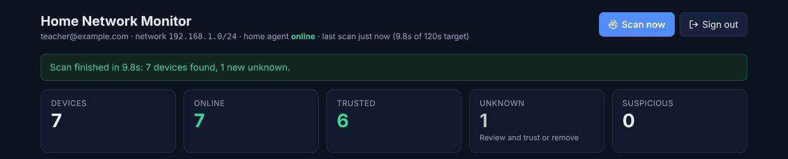

# Home Network Monitor: Dashboard (frontend)


The web dashboard of the Home Network Device Monitoring and Alert System. You sign in, see which devices are on your home network, mark the ones you recognise as **Trusted**, and get alerts when an **Unknown** device appears. The part that scans the network is in the [backend repository](https://github.com/nicholasT27/home-network-monitoring-backend).

**Just want to use it?** Open the live dashboard: https://home-network-monitoring-frontend.pages.dev, then follow the **Steps for a new user** in the [backend README](https://github.com/nicholasT27/home-network-monitoring-backend#steps-for-a-new-user).

## About

Most homes are set up once and never checked again, so the owner cannot tell when a new, unknown device joins the network. The **Home Network Device Monitoring and Alert System** finds the devices on a home network, tells the ones you know (**Trusted**) from the ones you do not (**Unknown**), and emails you when a new or suspicious device appears.

This repository is the **dashboard**: the web page where you create an account, see your devices, click **Scan now**, trust your own devices, and read the alerts. The scanning and alert logic are in the [backend repository](https://github.com/nicholasT27/home-network-monitoring-backend).

Built as the final year project for the CSN Project (TSN309/10), Wawasan Open University.

## Run the dashboard on your computer

You need [Node.js](https://nodejs.org) 20.19+ or 22. Check it by typing `node -v` in a terminal.

**1. Download this project.** Click the green **Code** button, then **Download ZIP**, and unzip it.

**2. Tell it where the backend is.** In the unzipped folder, copy the file `.env.example` and name the copy `.env`. Open `.env` and set this line, which points to the live backend:

```
VITE_API_BASE_URL=https://home-network-monitoring-backend.wasmer.app
```

**3. Install and start it.** Open a terminal in the folder and type:

```bash
npm install
npm run dev
```

**4. Open http://localhost:5173**, click **Create an account**, and sign in. To see the devices on your network you also run the home agent: follow the steps in the [backend README](https://github.com/nicholasT27/home-network-monitoring-backend#steps-for-a-new-user).

| Sign in | Create an account |
|---|---|
|  |  |

## What you see

| Network and alerts | Home agent | Active alerts |
|---|---|---|
|  |  |  |

- **Scan now** (top right) starts a scan; the banner shows when it is finished.
- The five tiles count devices, online, trusted, unknown and suspicious.
- In the device list, **Trust** marks a device as known; the pencil renames it, the clock shows its history, the bin removes it.
- **Network & alerts** sets the network range and the email address for alerts.


