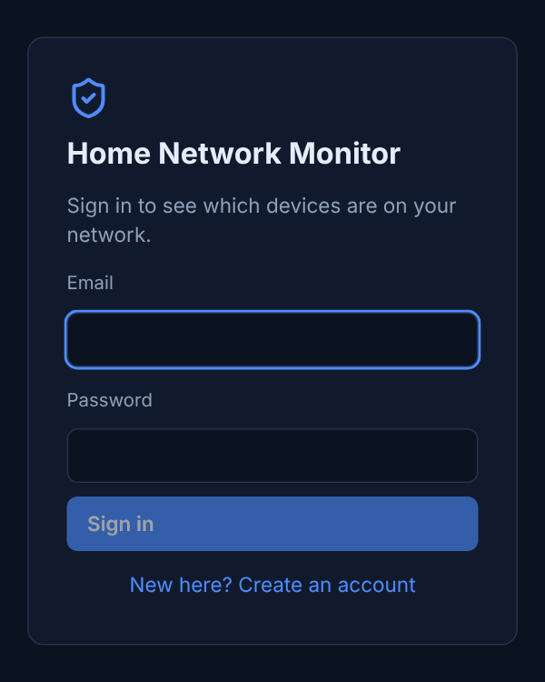
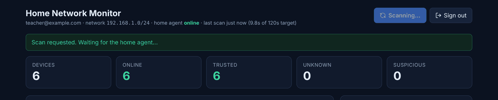

# Home Network Monitor: Dashboard (frontend)


The web dashboard of the **Home Network Device Monitoring and Alert System** (React + Vite), a student project for the CSN Project (TSN309/10) at Wawasan Open University. People create an account, see which devices are on their home network, mark the ones they recognise as **Trusted**, and get alerts when an **Unknown** or **Suspicious** device appears.

This repository is only the dashboard. It talks to the backend over HTTPS, so you also need the backend:
**[home-network-monitoring-backend](https://github.com/nicholasT27/home-network-monitoring-backend)** (PHP API, database and the home agent that scans the network).

**Live system (for marking):** https://home-network-monitoring-frontend.pages.dev

```
Browser ──► Dashboard (this repo, static files on Cloudflare Pages)
               │  HTTPS, address set by VITE_API_BASE_URL
               ▼
            Backend (PHP + MySQL)  ◄── home agent running on a computer at home
```

## Install and run on your computer

You need **Node.js 20.19+ or 22** ([nodejs.org](https://nodejs.org); check with `node -v`) and the backend running (see the backend README, "Option A: quick demo", which takes about five minutes and needs no router or email).

**1. Download this repository:** on the GitHub page click the green **Code** button, then **Download ZIP**, and unzip it (or `git clone https://github.com/nicholasT27/home-network-monitoring-frontend.git`).

**2. Start the backend** in the backend folder (first time: copy `.env.example` to `.env` and set `SCAN_MODE=demo`):

```bash
php -S 127.0.0.1:8081 router.php
```

**3. Start the dashboard** in this folder:

```bash
npm install
cp .env.example .env        # Windows: copy .env.example .env  (it already points at http://127.0.0.1:8081)
npm run dev
```

**4. Open http://localhost:5173**, click **Create an account**, then **Scan now**.

| Sign in | Create an account |
|---|---|
|  |  |

To scan a real network instead of the demo data, run the home agent as described in the backend README ("Option B"). The **Home agent** panel in the dashboard shows the two lines the agent needs and turns **Online** when it runs.

## What the dashboard does

- Sign up and sign in (each account sees only its own devices).
- **Scan now**, summary tiles, active alerts and recent activity.
- Device list with Online/Offline, Trusted/Unknown/Suspicious labels, search and filters, rename, history and remove.
- **Network & alerts**: set the network range to scan and the email address for alerts (each with its own Save button), and send a test email.
- **Home agent** panel: whether the agent at home is online, and the two lines it needs.




| Network and alerts | Home agent | Active alerts |
|---|---|---|
|  |  |  |


## Build

```bash
npm run build               # writes the static site to dist/
npm run preview             # serves dist/ on http://localhost:4173 to check it
```

## Deploy on Cloudflare Pages

Cloudflare Pages hosts the static dashboard for free. (It cannot run the PHP backend; that goes on a PHP host, see the backend repository.)

1. Sign in at https://dash.cloudflare.com and open **Workers & Pages** → **Create** → **Pages** → **Connect to Git** (menu names change from time to time).
2. Choose this repository (`home-network-monitoring-frontend`) and the `main` branch.
3. Build settings:

   | Setting | Value |
   |---|---|
   | Framework preset | Vite (or None) |
   | Build command | `npm run build` |
   | Build output directory | `dist` |
   | Root directory | *(leave empty)* |

4. Under **Environment variables** (Production) add:
   - `VITE_API_BASE_URL` = the address of your backend, **with `https://` and no trailing slash**, for example `https://your-backend.example.com` or `https://your-site.example.com/api`. This is the folder that contains the backend's `index.php`.
   - (`NODE_VERSION` = `22` is already set by the `.node-version` file; add it as a variable only if the build complains about the Node version.)
5. Click **Save and Deploy**. Cloudflare gives you an address such as `https://home-network-monitoring-frontend.pages.dev`.
6. **Allow that address in the backend.** In the backend's `.env` add `ALLOWED_ORIGINS=https://home-network-monitoring-frontend.pages.dev` (your real Pages address), then reload the backend. Without this the browser blocks the dashboard's requests (a CORS error).
7. Open the Pages address, create an account, and follow the **Home agent** panel.

Every push to `main` redeploys the dashboard automatically. If you change `VITE_API_BASE_URL`, redeploy (the value is read when the site is built). To change the backend address without rebuilding, edit `public/config.js` instead (see the comments in that file).

### Using Cloudflare with a backend that is not on HTTPS

The dashboard is served over HTTPS, so browsers refuse to call a backend over plain `http://` (mixed content). Give the backend an `https://` address (most hosts offer a free certificate).

## Troubleshooting

| What you see | Cause and fix |
|---|---|
| "Cannot reach the monitoring server" | `VITE_API_BASE_URL` is wrong or empty (check it in Pages → Settings → Environment variables, then redeploy), or the backend is down. |
| Browser console shows a CORS error | The dashboard's address is missing from `ALLOWED_ORIGINS` in the backend's `.env` (it must match exactly, e.g. `https://name.pages.dev`, no trailing slash). |
| Request blocked as "mixed content" | The backend address starts with `http://`. Use `https://`. |
| The API answers with an HTML page instead of JSON | The host is putting a security page in front of the API (some free hosts do this). Open the API address in a browser and see the backend README, section "Choosing a host". |
| Build fails on Cloudflare | Check the build log; make sure the build command is `npm run build` and the output directory is `dist`. |

## Project layout

```
index.html  vite.config.js  package.json  .node-version  .env.example
public/config.js            optional override of the backend address (no rebuild needed)
docs/images/               screenshots used in this README
src/
  main.jsx  App.jsx         app shell: sign-in gate, polling, scan button
  api.js                    all calls to the backend, token handling
  format.js                 time and network-address helpers
  styles.css
  components/               Login, DeviceList, AlertsPanel, ActivityPanel,
                            SettingsPanel, AgentPanel, Tile, Note
```

Part of the CSN project "Home Network Device Monitoring and Alert System" (Wawasan Open University).
