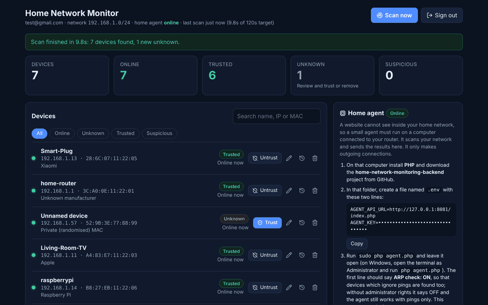
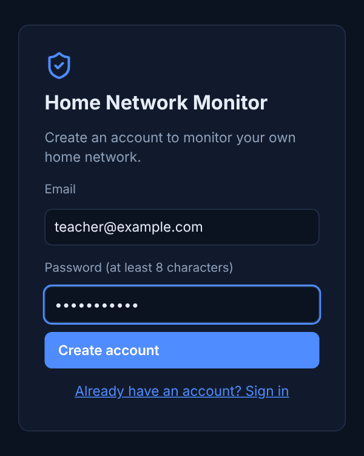
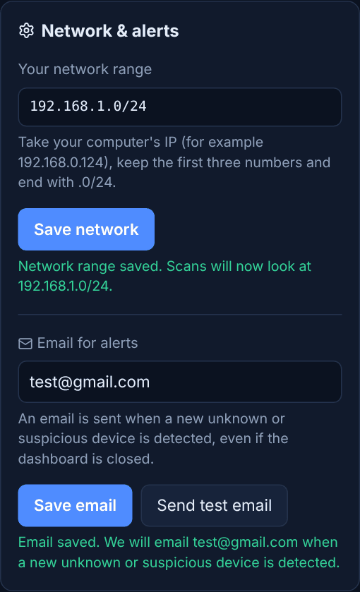
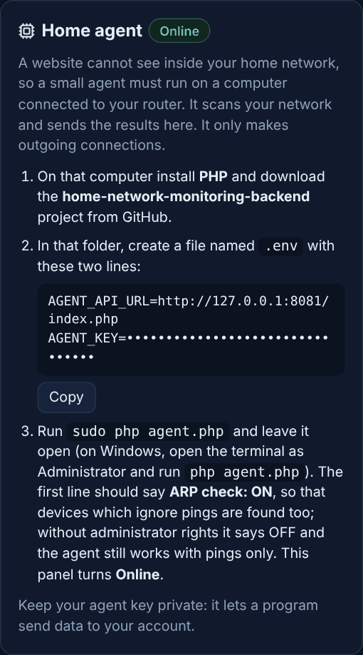
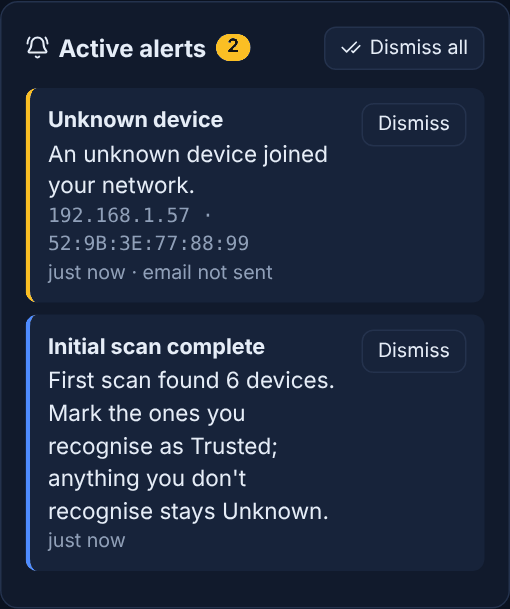

# Home Networking Monitoring System: Dashboard (frontend)

The web dashboard of the Home Networking Monitoring System. Once it is set up, you sign in, see which devices are on your home network, mark the ones you recognise as **Trusted**, and get alerts when an **Unknown** device appears.

**Before you use the dashboard:** a web page cannot see inside your home, so a small program called the **home agent** has to scan your network first. To see your connected devices, download the [backend repository](https://github.com/nicholasT27/home-network-monitoring-backend) and set it up by following its **Steps for a new user**. Then come back here and open the dashboard.

## About

Most homes are set up once and never checked again, so the owner cannot tell when a new, unknown device joins the network. The **Home Networking Monitoring System** finds the devices on a home network, tells the ones you know (**Trusted**) from the ones you do not (**Unknown**), and emails you when a new or suspicious device appears.

This repository is the **dashboard**: the web page where you create an account, see your devices, click **Scan now**, trust your own devices, and read the alerts. The scanning and alert logic are in the [backend repository](https://github.com/nicholasT27/home-network-monitoring-backend).

Built as the final year project for the CSN Project (TSN309/10), Wawasan Open University.

## Open the dashboard

**Step 1.** Set up the home agent first, as described in the [backend README](https://github.com/nicholasT27/home-network-monitoring-backend#steps-for-a-new-user): download the backend, then run it so it can scan your network.

**Step 2.** Then open the dashboard. Nothing to install or configure here, just click the link:

### 👉 [https://home-network-monitoring-frontend.pages.dev](https://home-network-monitoring-frontend.pages.dev)

**Step 3.** Sign in with the test account:

| | |
|---|---|
| Email | `test@gmail.com` |
| Password | `test12345` |

(Or click **Create an account** to use your own email.)

| Sign in | Create an account |
|---|---|
|  |  |

## What you see

| Network and alerts | Home agent | Active alerts |
|---|---|---|
|  |  |  |

- **Scan now** (top right) starts a scan; the banner shows when it is finished.
- The five tiles count devices, online, trusted, unknown and suspicious.
- In the device list, **Trust** marks a device as known; the pencil renames it, the clock shows its history, the bin removes it.
- **Network & alerts** sets the network range and the email address for alerts.

